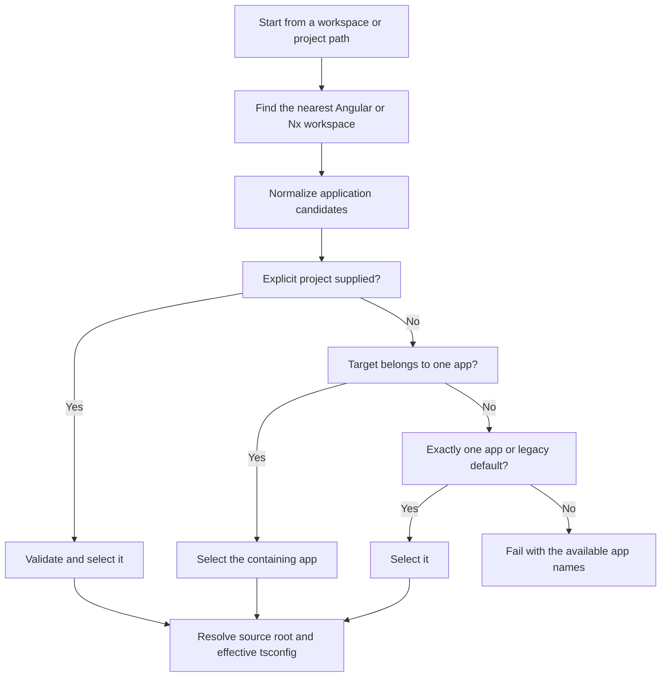

# Instruction: Discover the selected Nx application

## Architecture projection

> Tree of the final files. ✅ create · ✏️ modify · ❌ delete

```txt
.
├── src
│   ├── index.ts                                      ✏️ relativize graph paths from the workspace root
│   └── analyzer
│       ├── types.ts                                  ✏️ carry workspace and project TypeScript configuration context
│       ├── workspace-discovery.ts                    ✅ normalize Angular CLI and Nx project metadata
│       └── project-resolver.ts                       ✏️ select an Angular application and resolve its effective tsconfig
└── tests
    ├── analyzer
    │   └── project-resolver.test.ts                  ✅ cover project discovery, selection, and tsconfig inheritance
    └── fixtures
        ├── angular-workspace                         ✅ preserve the existing angular.json resolution contract
        └── nx-workspace
            ├── nx.json                               ✅ mark a modern Nx workspace
            ├── package.json                          ✅ expose Angular version and package-based Nx metadata
            ├── tsconfig.base.json                    ✅ define inherited workspace library aliases
            └── apps
                ├── admin
                │   ├── project.json                  ✅ describe a project.json-based Angular application
                │   └── tsconfig.app.json             ✅ inherit the workspace TypeScript configuration
                └── store
                    ├── package.json                  ✅ describe a package.json-based Angular application
                    └── tsconfig.app.json             ✅ exercise the fallback tsconfig lookup
```

No files are deleted in this phase.

## User Journey



## Tasks to do

### 1) Normalize workspace projects

> Represent Angular CLI and statically declared Nx applications through one project model.

1. Locate the nearest `angular.json` or `nx.json` without treating a modern Nx root as a single `<workspace>/src` app.
2. Read Angular CLI projects plus Nx `project.json` and `package.json#nx` metadata while skipping generated and dependency directories.
3. Normalize project name, type, root, source root, targets, and configuration source; derive `<projectRoot>/src` only when `sourceRoot` is absent.
4. Keep libraries discoverable for import resolution but exclude them from application selection.

### 2) Make application selection deterministic

> Analyze the intended app instead of silently choosing the first project.

1. Apply selection precedence: valid `--project`, app containing the target path, legacy default, then the sole application.
2. Reject an unknown project, a library selected as an app, or an ambiguous workspace with an error listing valid application names.
3. Support both `architect.build.options.tsConfig` and `targets.build.options.tsConfig`, then fall back through project and workspace tsconfig conventions when targets are inferred.
4. Resolve JSONC `extends` chains and TypeScript aliases relative to the configuration that declares them, preserving TypeScript's child override semantics.

### 3) Preserve workspace-relative graph metadata

> Keep app and library source paths readable in a shared workspace graph.

1. Add `workspaceRoot` and the selected `tsconfigPath` to the analyzer context.
2. Relativize entry, warning, source, and resolved import paths from `workspaceRoot`, not the selected app root.
3. Retain Angular CLI fallback behavior for non-Nx projects.

## Test acceptance criteria

| Task | Acceptance criteria |
| ---- | ------------------- |
| 1 | A modern Nx fixture without `angular.json` yields both applications and its libraries with their configured roots. |
| 2 | `admin` is selected explicitly or from a path below `apps/admin`; an unknown, library, or ambiguous selection reports the valid app names and never falls back to the first project. |
| 2 | The selected app inherits aliases from `tsconfig.base.json`, while a child `paths` declaration replaces the parent map as TypeScript specifies. |
| 3 | Graph-facing paths use `apps/...` and `libs/...` from the workspace root, and the Angular CLI fixture retains its previous project and source-root values. |
