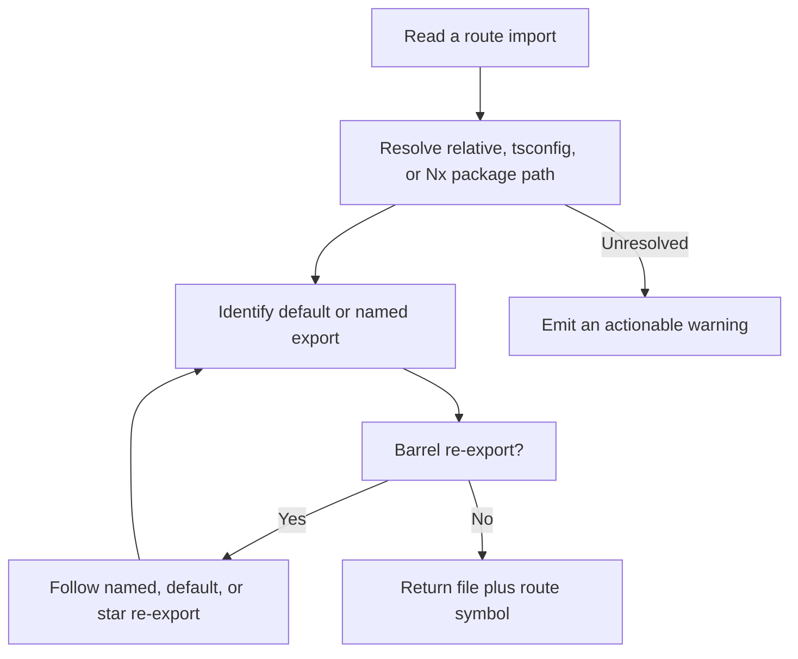

# Instruction: Resolve route sources across library boundaries

## Architecture projection

> Tree of the final files. ✅ create · ✏️ modify · ❌ delete

```txt
.
├── src
│   └── analyzer
│       ├── route-source-resolver.ts                  ✅ resolve imports and exported route symbols consistently
│       ├── route-finder.ts                           ✏️ trace provideRouter entries through aliases and barrels
│       └── route-parser.ts                           ✏️ consume symbol-aware lazy route sources
└── tests
    ├── analyzer
    │   ├── route-source-resolver.test.ts             ✅ verify path aliases, export selection, and barrel traversal
    │   └── route-finder.test.ts                      ✅ verify conventional and provider-based app entries
    └── fixtures
        └── nx-workspace
            ├── apps
            │   ├── admin/src/app
            │   │   ├── app.config.ts                ✅ expose a provider-based route entry
            │   │   └── app.routes.ts                ✅ mount lazy library routes
            │   └── store/src/app/app.routes.ts       ✅ prove app-specific entry selection
            └── libs
                ├── orders
                │   ├── project.json                  ✅ describe an Nx routing library
                │   └── src
                │       ├── index.ts                  ✅ re-export several named symbols through a barrel
                │       └── lib/orders.routes.ts      ✅ provide the specifically selected lazy route export
                └── order-detail
                    ├── project.json                  ✅ describe a second routing library
                    └── src
                        ├── index.ts                  ✅ exercise a star re-export
                        └── lib/order-detail.routes.ts ✅ continue a nested lazy route chain
```

No files are deleted in this phase.

## User Journey



## Tasks to do

### 1) Centralize static module resolution

> Resolve the same import to the same source from entry discovery and recursive parsing.

1. Resolve exact and longest-matching wildcard tsconfig aliases, relative paths, base-url paths, and statically declared local Nx package entry points.
2. Probe TypeScript files and index entry points in deterministic order without adding a runtime dependency or using Bun APIs.
3. Cache module resolution by importing file and specifier while keeping results workspace-scoped.

### 2) Preserve the requested export

> Follow the route array selected by Angular code instead of taking the first array in a file.

1. Extract direct dynamic imports, default exports, and `.then(module => module.routes)` export selection.
2. Follow named, aliased, default, and star re-exports through multi-level barrels with export-aware cycle protection.
3. Return both absolute source file and export identity to the parser.
4. Emit a warning containing the unresolved specifier and source location when static resolution stops.

### 3) Use the resolver for application entries

> Find provider-based root routes even when they live behind a workspace alias or barrel.

1. Replace regular-expression-only `provideRouter` tracing with AST-based identifier and import resolution.
2. Keep conventional `app.routes.ts` and `app-routing.module.ts` precedence unchanged.
3. Report a clear entry error when `provideRouter` is dynamic rather than returning an unparseable `app.config.ts` as a route file.

## Test acceptance criteria

| Task | Acceptance criteria |
| ---- | ------------------- |
| 1 | `@acme/orders`, wildcard aliases, relative imports, and index entry points resolve to deterministic workspace files. |
| 2 | `import('@acme/orders').then(module => module.ordersRoutes)` selects `ordersRoutes` even when the barrel exports another route array first. |
| 2 | Named, aliased, default, and star barrel chains terminate at the intended source; a barrel cycle terminates with one warning. |
| 3 | Root routes passed to `provideRouter` through an alias are found, while conventional standalone and NgModule entries retain their precedence. |
| 3 | A dynamic provider or unresolved import is visible as an actionable error or warning and never becomes a silently empty graph. |
