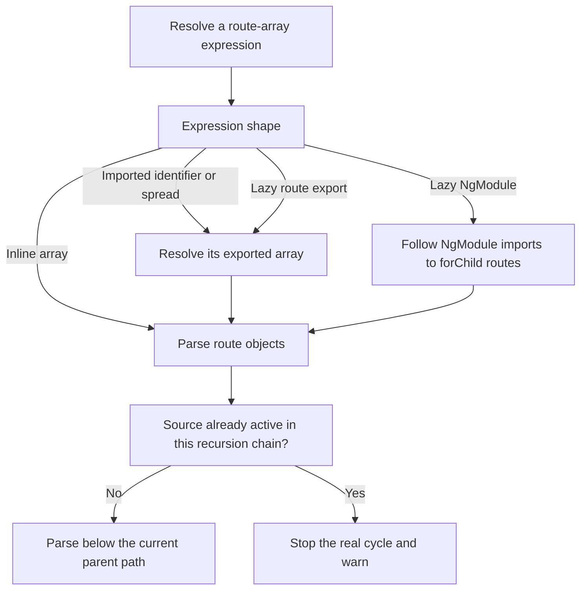

# Instruction: Compose nested routes without losing reuse or cycles

## Architecture projection

> Tree of the final files. ✅ create · ✏️ modify · ❌ delete

```txt
.
├── src
│   └── analyzer
│       └── route-parser.ts                           ✏️ resolve route-array expressions and contextual recursion
└── tests
    ├── analyzer
    │   ├── route-parser.test.ts                      ✅ cover imported, spread, lazy, and NgModule route composition
    │   └── route-reuse.test.ts                       ✅ distinguish reused fragments from actual cycles
    └── fixtures
        └── nx-workspace
            └── libs
                ├── orders/src/lib/orders.routes.ts   ✏️ compose imported and spread child fragments
                ├── order-detail/src/lib
                │   ├── order-detail.routes.ts        ✏️ add deeper nested routes
                │   └── shared-detail.routes.ts       ✅ provide a fragment mounted below multiple parents
                └── legacy-orders
                    ├── project.json                  ✅ describe an NgModule-based routing library
                    └── src
                        ├── index.ts                  ✅ export the lazy feature module
                        └── lib
                            ├── legacy-orders.module.ts         ✅ import the feature routing module
                            └── legacy-orders-routing.module.ts ✅ register routes with RouterModule.forChild
```

No files are deleted in this phase.

## User Journey



## Tasks to do

### 1) Recognize Angular route-array forms

> Parse the route symbol selected by its consumer across common Angular and Nx syntax.

1. Recognize `Routes`, `Route[]`, readonly arrays, `as` and `satisfies` wrappers, default arrays, and an untyped array when its symbol is explicitly selected.
2. Resolve local or imported identifiers used as the root array, `children`, `loadChildren`, or an array spread.
3. Preserve source file and line attribution for route objects originating in libraries.
4. Keep the existing conditional-spread behavior and warn on expressions that cannot be resolved statically.

### 2) Traverse standalone and NgModule sub-routing

> Continue through library-owned route fragments regardless of Angular routing style.

1. Parse selected standalone route exports returned by `loadChildren`.
2. When the selected lazy export is an NgModule, follow its static `NgModule.imports` chain to `RouterModule.forChild` route arrays.
3. Compose exact full paths across consecutive app and library boundaries.
4. Leave arbitrary async callbacks and Module Federation loaders unresolved with a location-aware warning.

### 3) Separate reuse from cycle detection

> Permit one route fragment to be mounted more than once while still terminating true recursive imports.

1. Key route-source identity by absolute file and exported symbol.
2. Track an active recursion stack for cycle detection instead of treating every previously parsed file as a cycle.
3. Cache context-free route expressions or source resolution only; rebuild route nodes and IDs for each parent path.
4. Preserve a single shared ts-morph `Project` configured with the selected app tsconfig.

## Test acceptance criteria

| Task | Acceptance criteria |
| ---- | ------------------- |
| 1 | Both `Routes` and `Route[]` exports contribute nodes, and `children: importedRoutes` plus `...importedRoutes` retain every statically defined child. |
| 2 | The fixture produces `/orders/:id/history` through consecutive app and library route sources with correct library source attribution. |
| 2 | A lazy NgModule contributes its `RouterModule.forChild` routes; an arbitrary runtime loader contributes no invented routes and emits a warning. |
| 3 | Mounting the same shared fragment below two parents produces two complete subtrees with distinct full paths and IDs. |
| 3 | A true file-and-export recursion terminates, emits one cycle warning for that branch, and does not suppress unrelated routes. |
